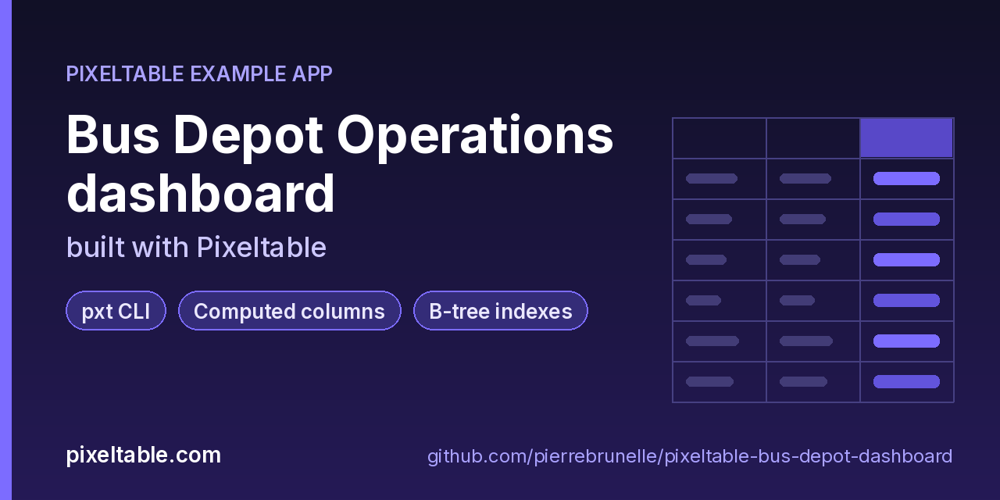

<!-- pixeltable-example-app: 20261018-bus-depot-dashboard -->
# Bus Depot Operations dashboard built with Pixeltable



[](https://codespaces.new/pierrebrunelle/pixeltable-bus-depot-dashboard?quickstart=1)
[](https://pixeltable.com)
[](https://pypi.org/project/pixeltable/)
[](https://github.com/pixeltable/pixeltable)
[](LICENSE)

`Depots`, `Buses` and `Trips` hold a small transit fleet. Each trip stores the delay at every stop as a JSON list; computed columns derive the final delay, the late stops and the worst stops with `pixeltable.functions.map` / `filter` / `sort`, a delay band, the hour of departure, and the parsed CAN-bus telemetry line from the bus logger. `dashboard.py` turns the tables into a static report (`output/dashboard.md` and `output/dashboard.html`): a depot scorecard and a route reliability table built from `group_by` aggregates (built-in `count`, `sum`, `mean`, `max` plus two custom UDAs from `udfs.py`, `percentile` for the p90 delay and `on_time_rate`), delay by departure hour, `distinct()` lookups of the fleet mix and the worst stop per route, a windowed running passenger total, and a data-health section that lists rows whose telemetry column failed. No HTTP router.

[Pixeltable](https://pixeltable.com) is open-source, Python-native **multimodal AI data infrastructure**: tables, incremental computed columns, UDFs, indexes and serving in one library, running locally or on Pixeltable Cloud.

> ⭐ **Like this example?** Star [pixeltable/pixeltable](https://github.com/pixeltable/pixeltable) on GitHub. It helps other developers find it.

## What this example shows

- **`pxt` CLI and local dashboard** for exploring tables and computed columns
- **Incremental computed columns** powered by plain Python UDFs (`@pxt.udf`)
- **B-tree indexes** declared on the model (`__indexes__`) back the lookup queries
- **`pixeltable.toml` project config**: local and Pixeltable Cloud database sizing in one file
- **Pixeltable Cloud lifecycle** from the `pxt` CLI (`db`, `schema`, `service`)
- **Importable UDF module**: UDFs live in `udfs.py`; tables and queries live in `app.py` (Pixeltable resolves UDFs by module path)
- **`pixeltable.toml`** declares a local database and a **Pixeltable Cloud** database, so the same code deploys with `pxt db update`

## What the dashboard computes

| Section | Pixeltable feature |
|---|---|
| Depot scorecard, route reliability | `group_by` with `count` / `sum` / `mean` / `max` and the custom UDAs `on_time_rate` and `percentile(q=0.9)` |
| Delay by departure hour | `group_by(trips.hour)` over the `hour` computed column (`local_hour` UDF: hour on the depot clock) |
| Fleet mix, routes served, worst stop per route | `select(...).distinct()` |
| Running passenger total | window aggregate `sum(passengers, group_by=route, order_by=departure)` |
| Data health | `where(trips.telemetry_parsed.errortype != None)` plus `pxt errors depots/trips` |

The per-stop delays are a JSON list like `[{"stop": "Docks", "delay": 2.5}, ...]`; `map(stops, lambda x: x.delay)`, `filter(stops, lambda x: x.delay > 5.0)` and `sort(stops, key=lambda x: x.delay, asc=False)` keep the derived lists next to the raw data and update them on every insert.

## Debugging a failing computed column

The seed data includes buses with newer logger firmware that writes `soc:81 temp:34.5 faults:` instead of `soc=81;temp=34.5;faults=`. With a parser that only knows the old format, those rows land in `pxt errors depots/trips` (the insert still succeeds; the error is stored per cell). After fixing `parse_telemetry` in `udfs.py`, `pxt recompute depots/trips telemetry_parsed --errors-only -f` re-evaluates only the failed cells.

## Notes

- `distinct()` and `group_by` on a JSON path (`worst_stops[0].stop`) are not grouped in SQL; the app stores the value as its own column (`worst_stop = worst_stops[0].stop.astype(pxt.String | None)`) and runs `distinct()` on that.
- Cast JSON paths with `pxt.String | None`, not `pxt.String`: a JSON path can be null (cancelled trips have no stops), and a non-nullable cast fails when the column is added.
- Insert timezone-aware datetimes when the same data goes to a local catalog and to Pixeltable Cloud: naive datetimes are read in the session time zone, which is the machine's zone locally and UTC in the cloud.

## What's inside

| File | What it is |
|------|------------|
| `.devcontainer/devcontainer.json` | GitHub Codespaces / Dev Container config: Python 3.12, installs `requirements.txt` |
| `.github/social-preview.png` | Social preview image (1280x640) |
| `CITATION.cff` | Citation metadata (authors, license, release date, keywords) |
| `app.py` | Tables declared as Python classes and `@pxt.query` functions |
| `dashboard.py` | Build the depot operations dashboard as output/dashboard.md and output/dashboard.html |
| `pixeltable.toml` | Project config: the local database plus a Pixeltable Cloud database (sizing, deploy excludes) |
| `seed.py` | Insert a deterministic demo fleet: 3 depots, 18 buses and two weeks of trips |
| `udfs.py` | Pixeltable UDFs (`@pxt.udf`) in their own importable module, imported by `app.py` |
| `requirements.txt` / `pyproject.toml` | Dependencies (`pixeltable>=0.7.18`) |

**Tables**

| Table | Stored columns | Computed columns |
|-------|---------|------------------|
| `depots` | `depot_id`, `name`, `city`, `bays` | - |
| `buses` | `bus_id`, `depot_id`, `model`, `fuel`, `year` | - |
| `trips` | `trip_id`, `bus_id`, `depot_id`, `route`, `departure`, `passengers`, `stops`, `telemetry` | `stop_delays`, `late_stops`, `worst_stops`, `final_delay`, `worst_stop`, `band`, `hour`, `telemetry_parsed` |

## Run in your browser (GitHub Codespaces)

[](https://codespaces.new/pierrebrunelle/pixeltable-bus-depot-dashboard?quickstart=1)

1. Click **Open in GitHub Codespaces** above (or [this link](https://codespaces.new/pierrebrunelle/pixeltable-bus-depot-dashboard?quickstart=1)). The dev container installs Python 3.12 and `pixeltable>=0.7.18` from `requirements.txt`.
2. In the codespace terminal, create the tables, seed them and run the app:

   ```bash
   pxt schema update app.py depots
   python seed.py                         # 3 depots, 18 buses, 504 trips
   pxt errors depots/trips                # rows whose computed telemetry column failed (none with the bundled udfs.py)
   python dashboard.py                    # writes output/dashboard.md and output/dashboard.html
   pxt history depots/trips               # one version per insert / schema change
   ```


## Quickstart

Requires Python 3.11+ and `pixeltable>=0.7.18`.

```bash
git clone https://github.com/pierrebrunelle/pixeltable-bus-depot-dashboard.git
cd pixeltable-bus-depot-dashboard
python -m venv .venv && source .venv/bin/activate
pip install -r requirements.txt

# Create the tables in a local catalog directory named `depots`
pxt schema update app.py depots

python seed.py                         # 3 depots, 18 buses, 504 trips
pxt errors depots/trips                # rows whose computed telemetry column failed (none with the bundled udfs.py)
python dashboard.py                    # writes output/dashboard.md and output/dashboard.html
pxt history depots/trips               # one version per insert / schema change
```

## Deploy to Pixeltable Cloud

The same `app.py` runs on [Pixeltable Cloud](https://pixeltable.com). Sign in (or get a free trial database with `pxt new`), point the second database entry in `pixeltable.toml` at your own database, then deploy:

```bash
pxt login                       # or: export PIXELTABLE_API_KEY=<your-api-key>
# edit pixeltable.toml: name = 'pxt://<your-org>:<your-db>'
pxt db update pxt://<your-org>:<your-db>                 # build the image and upload the project
pxt schema update app.py pxt://<your-org>:<your-db>/depots   # create the tables in the hosted database
```

Keep keys in environment variables or `pxt secret set`, never in code.

## Code walkthrough

**1. Business logic is plain Python, in `udfs.py`.** A `@pxt.udf` function can be used as a column expression. Pixeltable records UDFs by module path (`udfs.last_value`), so they live in their own importable module rather than inline in the app: the daemon, serving workers and Pixeltable Cloud import it again by that path.

```python
# udfs.py
@pxt.udf
def last_value(values: pxt.Json) -> float | None:
    """Delay at the final stop of a trip (the last element of the per-stop delay list)."""
    if not values:
        return None
    return float(values[-1])
```

**2. Tables are Python classes (`app.py`).** Annotated attributes are stored columns; attributes assigned an expression are **computed columns** (`stop_delays`, `late_stops`, `worst_stops`, `final_delay`, `worst_stop`, `band`, `hour`, `telemetry_parsed`), evaluated incrementally on every insert or update and recomputed when their inputs change. Indexes live next to the columns.

```python
# app.py
class Trips(TableModel, name='trips'):
    """One scheduled trip: per-stop delays (JSON list of {stop, delay}) and the logger's telemetry line."""

    trip_id = pxt.Column(type=pxt.String, primary_key=True)
    bus_id: pxt.String
    depot_id: pxt.String
    route: pxt.String
    departure: pxt.Timestamp
    passengers: pxt.Int
    stops: pxt.Json
    telemetry: pxt.String

    stop_delays = pxtf.map(stops, lambda x: x.delay)
    late_stops = pxtf.filter(stops, lambda x: x.delay > 5.0)
    worst_stops = pxtf.sort(stops, key=lambda x: x.delay, asc=False)
    final_delay = last_value(stop_delays)
    worst_stop = worst_stops[0].stop.astype(pxt.String | None)
    band = delay_band(final_delay)
    hour = local_hour(departure)
    telemetry_parsed = parse_telemetry(telemetry)

    __indexes__ = [pxt.BtreeIndex(depot_id), pxt.BtreeIndex(route)]
```

**3. Queries are functions (`app.py`).** `@pxt.query` wraps a Pixeltable query so it can be called from Python or exposed as a route:

```python
# app.py
@pxt.query
def depot_trips(depot_id: str, min_delay: float = 0.0):
    """Trips of one depot whose final delay is at least min_delay minutes, worst first."""
    return (
        Trips.where((Trips.depot_id == depot_id) & (Trips.final_delay >= min_delay))
        .order_by(Trips.final_delay, asc=False)
        .select(Trips.trip_id, Trips.route, Trips.departure, Trips.final_delay, Trips.band)
    )
```

## Learn more

- 🌐 Website: https://pixeltable.com
- 📚 Docs: https://docs.pixeltable.com
- 💻 Source: https://github.com/pixeltable/pixeltable (⭐ star it if Pixeltable is useful to you)
- 📦 PyPI: https://pypi.org/project/pixeltable/
- 🧩 More example apps: https://pierrebrunelle.github.io/awesome-pixeltable-apps/

**[More Pixeltable example apps →](https://pierrebrunelle.github.io/awesome-pixeltable-apps/)**

---

<sub>Built as part of a daily series of Pixeltable example apps · Pixeltable 0.7.18 · Python, incremental computed columns · Licensed under Apache-2.0.</sub>
